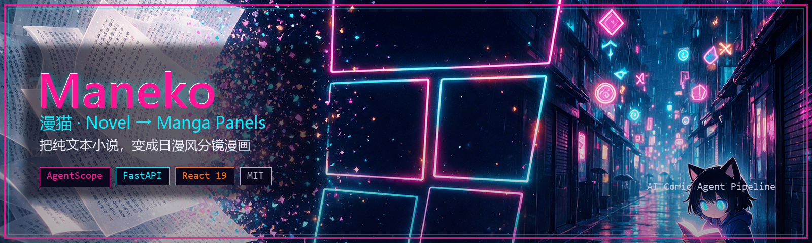

<div align="center">

# Maneko · 漫猫

**把纯文本小说，变成日漫风分镜漫画**

基于 [AgentScope](https://github.com/agentscope-ai/agentscope) 的 AI 小说 → 漫画生成应用。上传小说，自动分章、生成分镜脚本，并产出可预览的章节漫画。

[](LICENSE)
[](backend/requirements.txt)
[](backend)
[](frontend)
[](https://github.com/agentscope-ai/agentscope)
[](docker-compose.yml)

<br/>



<br/>
<br/>

*霓虹东京风格 · 猫娘看板娘 · 修仙 / 武侠 / 科幻 / 悬疑 等多题材预设*

</div>

---

## 为什么是 Maneko

> **Maneko** = **Manga** + **Neko**（猫）。  
> 中文名 **漫猫**——像招财猫一样，把一段段文字“招”成一格格漫画。

很多作者写完小说后，想看看“如果这章做成漫画会怎样”，但手工分镜、找画风、出图都很重。Maneko 把这条链路收成一次点击：

1. **读进小说** — 上传 `.txt` / `.md`
2. **智能分章** — AI（或本地规则回退）切出章节
3. **写出分镜** — 按题材生成 panel 脚本
4. **画出画面** — 按风格预设出图（支持 mock / qwen / wanx / mimo）
5. **分屏阅读** — 左侧原文，右侧对应漫画实时预览

## 功能特性

| 能力 | 说明 |
|------|------|
| 小说上传 | 纯文本 / Markdown，自动解析与分章 |
| 题材风格 | 修仙 · 武侠 · 科幻 · 悬疑 · 恐怖 · 奇幻 · 言情 · 都市 · 历史 · 日常 · 热血 · 霓虹东京 · 自动适配 |
| 漫画生成 | 章节级异步生成，panel 图片落盘 + 入库 |
| 分屏预览 | 左小说 / 右漫画，滚动对齐章节 |
| 个人书库 | 分类、收藏、阅读进度；书源聚合 |
| 开箱书源 | 本地上传 · 热门网文元数据 · Gutenberg · Wikisource · URL |
| 图片后端 | `mock`（离线）/ `qwen` / `wanx` / `mimo` 可切换 |
| 一键部署 | Docker Compose + Nginx 前端反代 |

## 架构一览

```text
┌─────────────────────────────────────────────────────────┐
│                   React 19 + Vite                       │
│   NovelReader  ·  ComicViewer  ·  Library  ·  Styles    │
└───────────────────────────┬─────────────────────────────┘
                            │  /api  +  /comics
┌───────────────────────────▼─────────────────────────────┐
│                     FastAPI (8001)                      │
│   routers → services → AgentScope agents                │
│   NovelParser  ·  ComicScript  ·  ComicGenerator        │
└───────────────┬─────────────────────────┬───────────────┘
                │                         │
        ┌───────▼────────┐        ┌───────▼────────┐
        │  SQLite + FS   │        │ Image Provider │
        │ novels.db      │        │ mock/qwen/wanx │
        │ uploads/comics │        │ /mimo          │
        └────────────────┘        └────────────────┘
```

更细的设计说明见 [`docs/superpowers/specs/`](docs/superpowers/specs/)，接口见 [`docs/API.md`](docs/API.md)。

## 快速开始

### 环境要求

- Python 3.11+
- Node.js 18+（建议 20+）
- （可选）Docker

### 1. 配置密钥

复制后端环境变量模板，并填入 DashScope Key（无 Key 时分章/分镜会走本地回退，出图默认 mock）：

```powershell
copy backend\.env.example backend\.env
# 编辑 backend/.env
```

```env
DASHSCOPE_API_KEY=sk-xxxxxxxx
IMAGE_PROVIDER=mock   # 开发默认；联调可改 qwen / wanx / mimo
```

### 2. 本地开发（推荐）

```powershell
# 仓库根目录，一键起后端 8001 + 前端 5173
.\start-dev.ps1
```

或手动启动：

```powershell
# 后端（必须在 backend/ 目录下，CWD 决定 .env / DB / 上传目录）
cd backend
py -3.11 -m pip install -r requirements.txt
py -3.11 -m uvicorn app.main:app --reload --host 0.0.0.0 --port 8001

# 前端（另开终端）
cd frontend
npm install
npm run dev
```

打开 <http://localhost:5173>。Swagger 文档：<http://localhost:8001/docs>。

### 3. Docker 部署

```powershell
$env:DASHSCOPE_API_KEY = "sk-xxxxxxxx"
docker-compose up -d --build
```

| 场景 | Backend | Frontend |
|------|---------|----------|
| 本地开发 | **8001** | **5173** |
| Docker | **8000** | **80** |

> 注意：请在 `backend/` 目录启动后端。在仓库根直接跑 uvicorn 会找错 `.env`、`novels.db` 和 `uploads/`、`comics/`。

## 配置项

完整模板见 [`backend/.env.example`](backend/.env.example)。

| 变量 | 说明 | 默认 |
|------|------|------|
| `DASHSCOPE_API_KEY` | 阿里云百炼 / DashScope API Key | 空（回退本地逻辑） |
| `IMAGE_PROVIDER` | 出图通道 `mock` \| `qwen` \| `wanx` \| `mimo` | `mock` |
| `QWEN_IMAGE_MODEL` | DashScope 文生图模型 | `qwen-image` |
| `QWEN_IMAGE_MODE` | 调用方式 `sdk` \| `http` \| `openai` | `sdk` |
| `MIMO_IMAGE_BASE_URL` | OpenAI 兼容出图服务地址 | `http://127.0.0.1:7342/v1` |
| `MIMO_IMAGE_API_KEY` | MiMo 出图 Key | 空 |
| `COMIC_STYLE` | 默认视觉风格 | `neon-tokyo` |
| `DATABASE_URL` | 数据库 | `sqlite:///./novels.db` |
| `UPLOAD_DIR` / `COMIC_DIR` | 上传与漫画目录 | `uploads` / `comics` |

## 项目结构

```text
.
├── assets/                 # README 海报等品牌素材
├── backend/
│   ├── app/
│   │   ├── agents/         # AgentScope：解析 / 分镜 / 出图 / 风格
│   │   ├── models/         # SQLAlchemy 模型
│   │   ├── routers/        # FastAPI 路由
│   │   ├── services/       # 业务逻辑（小说、漫画、书库、书源）
│   │   ├── config.py
│   │   └── main.py
│   └── tests/
├── frontend/
│   └── src/
│       ├── api/            # axios 客户端
│       ├── components/
│       ├── pages/
│       └── stores/         # Zustand
├── docs/                   # API / 部署 / 设计文档
├── scripts/make_poster.py  # 重新生成 README 海报
├── docker-compose.yml
├── start-dev.ps1
├── LICENSE
└── README.md
```

## 使用流程

1. 打开前端首页，上传小说或从「書庫 / 书源」导入  
2. 选择章节与风格（可 `auto` 按题材识别）  
3. 触发生成，右侧预览会随章节滚动出现对应分镜  
4. 在「漫画集」中查看已完成章节并整理导出  

## 开发命令

```powershell
# 前端
cd frontend
npm run dev      # 开发服 5173
npm run lint     # oxlint
npm run build    # 生产构建

# 后端测试（需自备 pytest；部分用例会打真实 DashScope）
cd backend
python -m pytest tests/ -v
```

## 发布（免费方案）

| 用途 | 平台 | 位置 |
|------|------|------|
| Web 前端 | **Vercel** Free | Root = `frontend`，`vercel.json` 反代 `/api` |
| 移动 App（PWA/APK 源码） | **Vercel** Free | Root = `maneko-app` |
| 后端 API | **Render** Free（Docker） | 根目录 `Dockerfile.backend` + `render.yaml` |
| 安卓 APK | **Capacitor** | `mobile-native/`，一键 `scripts/build-apk.ps1` |

完整步骤（含环境变量、CORS、签名）：**[docs/RELEASE.md](docs/RELEASE.md)**

```powershell
# 同步生产 App 到 Capacitor 并打调试 APK
.\scripts\build-apk-www.ps1
.\scripts\build-apk.ps1

# 打包前写入生产后端地址
.\scripts\set-prod-api.ps1 -ApiBase https://maneko-api.onrender.com
```

### 产品入口

| 入口 | 说明 |
|------|------|
| `frontend/` | 桌面/平板 Web 全功能站 |
| `maneko-app/` | 移动产品（书架/生成/漫画集/设置），可 PWA 安装 |
| `mobile-native/` | Capacitor Android 工程（打 APK） |

## 相关文档

- [API 文档](docs/API.md)
- [部署指南](docs/DEPLOYMENT.md)
- [发布 / Vercel / APK](docs/RELEASE.md)
- [移动 App](maneko-app/README.md)
- [架构设计](docs/superpowers/specs/2026-09-09-ai-novel-to-comic-design.md)

## 口号

**Maneko** — *Novel in, panels out.*  
让每一章小说，都有机会被「看见」。

## 许可证

本项目基于 [MIT License](LICENSE) 开源。

```text
Copyright (c) 2026 Maneko Contributors
```

使用模型与第三方 API 时，请遵守对应服务的使用条款；生成内容的版权归属请自行确认。
